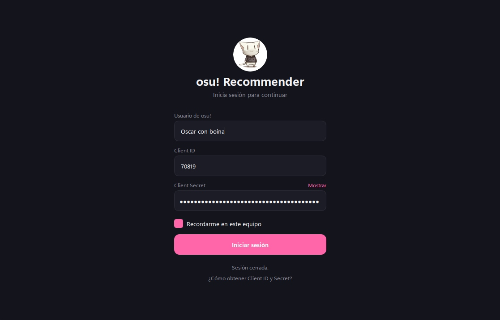
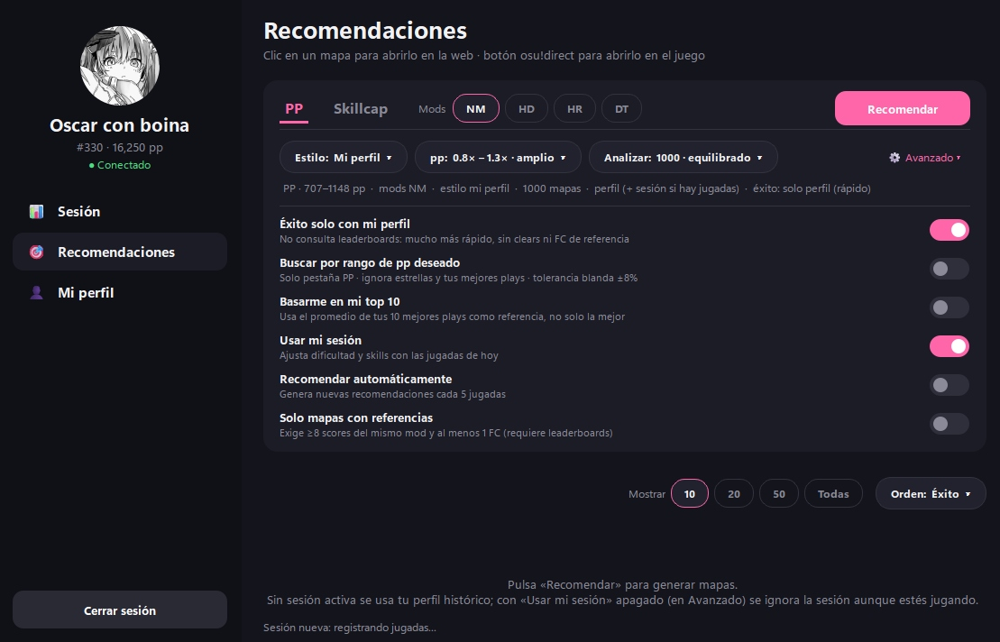
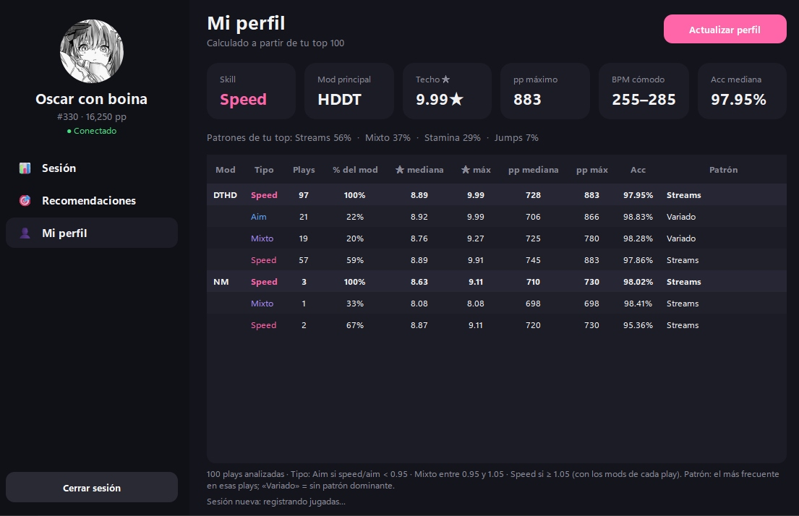

# osu! Beatmap Recommender — Guía de usuario

Programa para Windows que recomienda mapas de osu!standard a partir de **tus mejores plays** y de **lo que estás jugando hoy**. Tiene dos objetivos:

- **PP:** mapas que te den pp según tu nivel (para farmear).
- **Skillcap:** mapas cerca de tu techo de dificultad, para subir tu nivel, elegidos según las skills que juegas ahora.

> Esta guía describe la interfaz nueva (PySide6/Qt). Si PySide6 no está instalado, `app.py` abre la interfaz anterior (CustomTkinter), que no incluye HR ni el desglose del perfil.

<!--  -->

## Contenido

1. [Inicio rápido](#1-inicio-rápido)
2. [Instalación y archivos](#2-instalación-y-archivos)
3. [Inicio de sesión y credenciales](#3-inicio-de-sesión-y-credenciales)
4. [Pantalla Recomendaciones](#4-pantalla-recomendaciones)
5. [Pantalla Sesión](#5-pantalla-sesión)
6. [Pantalla Mi perfil](#6-pantalla-mi-perfil)
7. [Cómo se calcula cada número](#7-cómo-se-calcula-cada-número)
8. [Recetas](#8-recetas)
9. [Datos que guarda el programa](#9-datos-que-guarda-el-programa)
10. [Límites de la API y rendimiento](#10-límites-de-la-api-y-rendimiento)
11. [Solución de problemas](#11-solución-de-problemas)
12. [Limitaciones conocidas](#12-limitaciones-conocidas)
13. [Glosario](#13-glosario)

---

## 1. Inicio rápido

1. Ejecuta `dependencies.bat` (una sola vez).
2. Crea tu aplicación OAuth en osu! y copia el **Client ID** y el **Client Secret** (ver [sección 3](#3-inicio-de-sesión-y-credenciales)).
3. Abre el programa con `o!br.vbs` (o con el acceso directo del escritorio).
4. Escribe tu usuario, Client ID y Secret, deja marcado «Recordarme» y pulsa **Iniciar sesión**. La primera vez construye tu perfil y puede tardar unos minutos.
5. Ve a **Recomendaciones**, elige PP o Skillcap, marca los mods que quieres jugar y pulsa **Recomendar**.
6. Haz clic en una tarjeta para abrir el mapa en la web, o en **osu! direct** para abrirlo en el juego.

## 2. Instalación y archivos

**Requisito:** Python 3.10 o superior (probado con 3.14).

| Archivo | Para qué sirve |
|---|---|
| `dependencies.bat` | Instala los paquetes: requests, python-dotenv, rosu-pp-py, pillow, PySide6 y customtkinter. PySide6 pesa varios cientos de MB. Al final ofrece crear un acceso directo en el escritorio. |
| `o!br.vbs` | Abre el programa sin terminal. |
| `create_DA.vbs` | Crea el acceso directo «osu! Recommender» en el escritorio (muestra dónde quedó). |
| `app.py` | Punto de entrada. También sirve desde una terminal: `python app.py`. |
| `error.log` | Aparece si el programa no pudo iniciar. |
| `debug.log` | Se reescribe en cada arranque con los pasos del inicio y los avisos de Qt. |

Para desinstalar la interfaz nueva y volver a la anterior: `python -m pip uninstall PySide6`.

## 3. Inicio de sesión y credenciales

El programa usa la **API v2 de osu!** con una aplicación OAuth tuya. No usa la clave antigua (API v1).

**Cómo obtener Client ID y Secret**

1. Entra a <https://osu.ppy.sh/home/account/edit#oauth> (Configuración de la cuenta → OAuth).
2. Pulsa **New OAuth Application**, ponle cualquier nombre y deja vacía la URL de callback.
3. Copia el **Client ID** (número) y el **Client Secret**. Trátalo como una contraseña.

| Elemento de la pantalla | Qué hace |
|---|---|
| Usuario de osu! | Tu nombre de usuario. |
| Client ID / Client Secret | Credenciales de tu aplicación. «Mostrar» revela el secreto. |
| Recordarme en este equipo | Guarda las credenciales para no escribirlas otra vez. |
| Iniciar sesión | Valida las credenciales, busca tu usuario y carga o construye tu perfil. |
| ¿Cómo obtener Client ID y Secret? | Abre la página de OAuth de osu!. |

**Inicio automático:** si hay credenciales guardadas, el programa inicia sesión solo al abrirse. Mantén **Shift** pulsado al abrirlo para evitarlo. Si cierras sesión, vuelves a esta pantalla y no se reinicia sola hasta la próxima apertura.

**Seguridad:** con «Recordarme», las credenciales se guardan **en texto plano** en `data/credentials.env`. «Cerrar sesión y olvidar credenciales» (menú de tu foto) borra ese archivo.

## 4. Pantalla Recomendaciones

<!--  -->

La barra superior reúne todos los filtros. Debajo hay una línea de **resumen** que se actualiza sola y dice exactamente qué va a buscar, por ejemplo: `PP · 707–1148 pp · mods NM · estilo mi perfil · 1000 mapas · perfil (+ sesión si hay jugadas) · éxito: solo perfil (rápido)`.

### 4.1 Objetivo: PP o Skillcap

| Pestaña | Qué busca |
|---|---|
| **PP** | Mapas cuyo pp estimado cae en el rango que elijas (por defecto, 0.8× a 1.3× de tu mejor play). |
| **Skillcap** | Mapas entre 0.5★ por debajo y 0.4★ por encima de tu techo de estrellas, con preferencia por los que más se parecen a lo que juegas hoy. No usa filtro de pp. |

### 4.2 Mods (NM · HD · HR · DT)

Son interruptores combinables; siempre queda al menos uno activo. **NM** es el valor por defecto. HD y HR son complementos que generan variantes; con DT sin NM solo salen combinaciones con DT.

| Activos | Combinaciones que busca |
|---|---|
| NM | NM |
| HD | HD |
| HR | HR |
| NM + HD | NM, HD |
| NM + HR | NM, HR |
| HD + HR | HD, HR, HDHR |
| NM + HD + HR | NM, HD, HR, HDHR |
| DT | DT |
| DT + HD | DTHD |
| DT + HR | DTHR |
| DT + HD + HR | DTHD, DTHR, DTHDHR |
| NM + DT | NM, DT |
| NM + HD + DT | NM, HD, DT, DTHD |
| NM + HR + DT | NM, HR, DT, DTHR |

Notas:

- **«DTHD»** es lo que otras partes del programa llaman HDDT (mismos mods, otro orden).
- Las estrellas se comparan en la **misma escala para todos los mods**: si tu techo es ~10★ con DT, NM también busca alrededor de 10★. No se divide entre 1.45.
- Con **DT**, el BPM cómodo se escala ×1.5 y la duración efectiva se divide entre 1.5.
- Con **HR** se pide a la API un margen extra de estrellas, porque HR sube el rating respecto al mapa base.
- Cada combinación aparece en las tarjetas con su propia etiqueta de mods; un mismo mapa puede salir dos veces con mods distintos.

### 4.3 Pastillas de filtro

Se abren al hacer clic. Una pastilla con borde **rosado** tiene un valor distinto del predeterminado.

**Estilo**

| Opción | Efecto |
|---|---|
| Mi perfil · Parecidos a mis tops · Todos | No filtran. Todas ordenan por afinidad con tu estilo (en esta versión las tres se comportan igual). |
| Speed | Solo mapas con speed/aim ≥ 1.05. |
| Aim | Solo mapas con speed/aim < 0.95. |
| Híbrido | Solo mapas con speed/aim entre 0.95 y 1.05. |
| Streams · Jumps · Finger control · Stamina · Tech | Solo mapas que tengan ese patrón (ver [sección 7.5](#75-patrones-streams-jumps-finger-control-stamina-tech)). |

**pp** (solo pestaña PP): rango de pp como múltiplo de tu referencia (tu mejor play, o el promedio de tu top 10 si lo activas).

| Opción | Rango |
|---|---|
| 0.8× – 1.3× · amplio (predeterminada) | Con una referencia de 883 pp: unos 706–1148 pp. |
| 0.9× – 1.2× · estrecho | 795–1060 pp. |
| 0.7× – 1.0× · por debajo de tu top | 618–883 pp. |

También ajusta la ventana de estrellas: cuanto más ancho el rango, más ancha la búsqueda.

**Analizar:** máximo de mapas candidatos que se analizan (250 · rápido, 500, 1000 · equilibrado, 1500, 2000 · lento). Más candidatos dan más resultados y tardan más.

### 4.4 Panel ⚙ Avanzado

Se despliega con el botón «⚙ Avanzado».

| Interruptor | Qué hace |
|---|---|
| **Éxito solo con mi perfil** (activado) | Calcula el éxito sin consultar leaderboards: es mucho más rápido, pero las tarjetas no muestran clears ni FC de referencia. Apagado, consulta el ranking de cada mapa (ver [10](#10-límites-de-la-api-y-rendimiento)). |
| **Buscar por rango de pp deseado** | Solo pestaña PP. Escribes un **Mín** y un **Máx** de pp; se ignoran las estrellas y tus mejores plays como referencia. Tiene una tolerancia blanda de ±8%: un mapa justo fuera del rango se acepta con menos puntuación. Si Mín ≥ Máx o no son números, el resumen avisa y no calcula. Al activarlo propone ±10% alrededor de tu mejor play. |
| **Basarme en mi top 10** | Usa el promedio de pp de tus 10 mejores plays como referencia en lugar de la mejor. También desplaza la ventana de estrellas en proporción. |
| **Usar mi sesión** (activado) | Aplica el ajuste de dificultad de la sesión y, en Skillcap, las skills de tus últimas jugadas. Apagado, solo cuenta tu perfil histórico. |
| **Recomendar automáticamente** | Genera una recomendación nueva cada 5 jugadas registradas (si no hay otra en curso). |
| **Solo mapas con referencias** | Exige al menos 8 scores del mismo mod y 1 FC en el ranking. Requiere apagar «Éxito solo con mi perfil»; si está activado, este interruptor se ignora. |

### 4.5 Botones Recomendar y Detener

- **Recomendar** inicia el cálculo (siempre calcula todos los mapas que pasan los filtros).
- **Detener** aparece mientras calcula y cancela el proceso. Solo conserva resultados parciales si ya estaba revisando los leaderboards; antes de eso no hay resultados que mostrar.
- La barra de estado inferior muestra el avance, por ejemplo cuántos candidatos hay, el rango de pp por mod y, con leaderboards, el tiempo restante.

### 4.6 Barra de resultados

| Control | Función |
|---|---|
| `N mapas · mostrando M` | Cuántos mapas pasaron los filtros y cuántos se ven. |
| **Mostrar** 10 · 20 · 50 · Todas | Cuántos mostrar. Cambiarlo es instantáneo (no recalcula). Se cargan de 30 en 30 con el botón «Mostrar más». |
| **Orden** | PP: Éxito, pp esperados, pp × éxito. Skillcap: Afinidad, Éxito, Dificultad ★. También es instantáneo. |

### 4.7 La tarjeta de un mapa

Cada fila tiene tres partes: la columna de mods, la tarjeta y el botón **osu! direct**.

| Elemento | Significado |
|---|---|
| **MODS** (columna de color) | Con qué mods debes jugar el mapa (NM, HD, HR, DT, DTHD…). |
| Miniatura y título | Artista, título y dificultad. |
| `8.37★` | Rating del mapa **con esos mods**. |
| `174 BPM` | BPM efectivo (con DT, ya multiplicado). |
| `3:13` | Duración efectiva (con DT, ya dividida). |
| `ratio 0.85` | speed/aim del mapa: menos de 0.95 es más aim; más de 1.05, más speed. |
| Etiquetas de colores | Patrones detectados: Streams, Jumps, Stamina, Tech, Finger control. «Mixto» significa que ningún patrón domina. |
| **747 pp** (rosa) | pp **estimado** de esa jugada, no ponderado (ver [7.1](#71-pp-estimado)). |
| **Éxito 58%** | Estimación de lo viable que es para ti. Verde desde 45%, ámbar entre 25% y 45%, rojo por debajo (ver [7.2](#72-éxito)). |
| **Afinidad con tu estilo 59%** | Cuánto se parece a lo que sueles jugar (ver [7.3](#73-afinidad-con-tu-estilo)). |
| Línea gris inferior | «Éxito solo con tu perfil»; o `NN% clears · FC a/b` si se consultó el ranking; o `Sin referencia (n/8 scores)` si el ranking tiene pocos scores con esos mods. |

**Clics:** en cualquier parte de la tarjeta se abre el mapa en la web. El botón **osu! direct** lo abre dentro del juego con `osu://b/<id>`; osu! debe estar instalado, y osu!direct en el cliente stable requiere ser supporter. Si falla, la barra de estado lo indica.

## 5. Pantalla Sesión

Una **sesión** es el periodo desde que abres el programa (o pulsas «Nueva sesión») hasta ahora. El programa consulta tus jugadas recientes de osu!standard **cada 60 segundos**, incluyendo las falladas, y solo registra las que ocurrieron **después** del inicio de la sesión. Si el programa está cerrado, esas jugadas no se registran.

| Tarjeta | Significado |
|---|---|
| **Jugadas** | Cuántas jugadas se registraron en la sesión (aprobadas y falladas). |
| **Precisión (pases)** | Precisión media de las jugadas aprobadas. |
| **Fallos** | Porcentaje de jugadas falladas (verde hasta 40%, rojo por encima). |
| **Duración** | Minutos entre la primera y la última jugada. |
| **Ajuste de dificultad** | Cuánto subir o bajar las estrellas según cómo vas hoy (ver abajo). Muestra «—» si todavía no hay suficientes jugadas. |

La tabla lista cada jugada (hora, mapa, mods, precisión, misses, pp y resultado); las falladas salen en rojo. **Doble clic** abre el mapa en la web. **Nueva sesión** vacía la lista y empieza a registrar desde ese momento.

**Cuándo aparece el ajuste:** hacen falta **5 jugadas con el mismo mod que tu mod principal** (por ejemplo, 5 jugadas con DTHD si ese es tu mod principal; las falladas cuentan). Jugar con otros mods no activa el ajuste.

**Cómo se calcula** (valores más recientes pesan más, con un decaimiento de 0.9 por jugada):

- Compara tu precisión de hoy con tu precisión mediana: cada +1% de diferencia mueve +0.25★.
- Si fallas más del 35% de las jugadas, resta 0.6★ por cada unidad por encima de ese umbral.
- Después de 90 minutos jugando, resta 0.15★ por cada hora extra (hasta −0.30★) por cansancio.
- El resultado se limita entre −0.5★ y +0.4★ y se suaviza con pocas jugadas (con 5 jugadas cuenta aproximadamente el 38%).
- También estima cuántos misses asumir (0 a 4) y, con al menos 3 jugadas buenas, mueve tu BPM cómodo (hasta ±25).

La línea gris bajo las tarjetas lo resume, por ejemplo: `Ajuste activo: +0.05★ | acc +0.30% | misses supuestos 2 | BPM +3`.

## 6. Pantalla Mi perfil

<!--  -->

El perfil se calcula con tu **top 100** y se guarda; pulsa **Actualizar perfil** para volver a descargarlo y recalcularlo (por ejemplo, tras nuevos tops).

| Tarjeta | Significado |
|---|---|
| **Skill** | Speed, aim o híbrido, según la mediana de speed/aim de tus plays con el mod principal (más de 1.05 = speed; menos de 0.95 = aim). |
| **Mod principal** | La combinación de mods con más plays en tu top 100. Aquí se muestra con su nombre interno (HDDT = DTHD). |
| **Techo ★** | La mayor dificultad (con mods) entre tus plays del mod principal. |
| **pp máximo** | El pp de tu mejor play con ese mod. |
| **BPM cómodo** | Del percentil 10 al 90 del BPM efectivo de tus tops (DT ×1.5, HT ×0.75). |
| **Acc mediana** | Tu precisión mediana con el mod principal. |

**Patrones de tu top:** porcentaje de tus plays que tienen cada patrón. Una play puede tener varios, así que los porcentajes pueden sumar más de 100%.

**Tabla de desglose.** Por cada combinación de mods hay una fila resumen (en negrita) y una fila por tipo de play:

| Columna | Significado |
|---|---|
| Mod | Combinación (DTHD, NM…). Las combinaciones con más plays van primero. |
| Tipo | En la fila resumen, el tipo **principal** de esa combinación. En las demás: Aim, Mixto, Speed o Sin datos (si el mapa no se pudo leer). |
| Plays / % del mod | Cuántas plays y qué proporción del mod. |
| ★ mediana / ★ máx | Dificultad con los mods de cada play. |
| pp mediana / pp máx | De tus scores reales. |
| Acc | Precisión mediana. |
| Patrón | El patrón más frecuente en esas plays. «Variado» significa sin patrón dominante. |

El **tipo** sale de la proporción speed/aim de cada mapa, calculada con los mods con que lo jugaste: **Aim** si es menor que 0.95, **Mixto** entre 0.95 y 1.05, **Speed** si es 1.05 o más. Las filas no se pueden seleccionar. Los datos del desglose se guardan, así que las siguientes aperturas son inmediatas.

Con pocas plays (por ejemplo 3 en NM) las medianas no son fiables; el programa las muestra igual con su cantidad. Para recomendar, solo usa tus datos de un mod si tiene **al menos 5 plays**; si no, los deriva de tu mod principal.

## 7. Cómo se calcula cada número

### 7.1 pp estimado

Para cada mapa y cada combinación de mods, el programa calcula con la librería `rosu-pp` el pp de una jugada con:

- **Precisión supuesta:** tu precisión mediana con ese mod, menos 1.2 puntos por cada estrella por encima de tu dificultad mediana (mínimo 90%).
- **Misses supuestos:** 2 por defecto, o el valor que sale del ajuste de sesión si está activo.
- **Combo:** el máximo del mapa.

Es el pp **bruto** de esa jugada. En tu perfil, el pp cuenta ponderado por posición (tu mejor play cuenta 100%, la segunda 95%, y así), así que lo que ganarías en tu total es menos.

### 7.2 Éxito

Es un puntaje relativo de viabilidad, no una probabilidad exacta. Combina:

- **Dificultad frente a tu techo (punto de partida):** vale 50% cuando el mapa está a mitad de camino entre tu dificultad mediana y tu techo, sube por debajo y cae rápido por encima (la transición dura unos 0.35★). Ese valor se multiplica por los demás factores, por eso los porcentajes mostrados suelen ser menores.
- **Pass rate global del mapa:** penaliza mapas que casi nadie pasa (hasta −30%).
- **Duración:** penaliza mapas de más de 3 minutos (hasta −40%).
- **BPM fuera de tu rango cómodo.**
- **Afinidad** con tu estilo.
- Con leaderboards: la **tasa de clears** (ver [10](#10-límites-de-la-api-y-rendimiento)).

### 7.3 Afinidad con tu estilo

Mezcla a partes iguales:

- Qué tan cerca está el speed/aim del mapa del de tus plays (dentro de unos 0.4 de diferencia).
- Qué tanto se parece su **huella** al promedio de tus mejores plays. La huella resume el mapa por densidad de streams, el stream más largo, jumps, finger control, velocidad, ángulos, sliders, variedad rítmica y picos de dificultad; tus plays de más pp pesan más.

En **Skillcap**, el 70% viene de tus jugadas recientes y el 30% de tu perfil. Se descartan los mapas con afinidad menor a 25%.

### 7.4 Skills actuales (Skillcap)

Toma tus últimas 30 jugadas aprobadas de la sesión (las recientes pesan más) y calcula tu speed/aim y tus patrones de hoy. Con 10 jugadas o más, la sesión pesa 70% y tu perfil 30%; con menos, pesa más el perfil. Sin jugadas aprobadas, usa solo el perfil.

### 7.5 Patrones (Streams, Jumps, Finger control, Stamina, Tech)

Se detectan leyendo los objetos del mapa:

| Patrón | Se marca cuando… |
|---|---|
| **Streams** | Al menos el 30% de las notas forman streams (tramos de 5 o más notas seguidas a 1/4 de beat). |
| **Jumps** | Al menos el 30% de las notas están en tramos de saltos largos (más de ~1.8 diámetros de círculo) a ritmo medio. |
| **Finger control** | Al menos el 20% de las notas son saltos cortos de dedos a velocidad de stream. |
| **Stamina** | Hay un stream de 75 notas o más, o al menos el 30% son streams sin picos de dificultad. |
| **Tech** | Alta variedad rítmica, ritmos impares, irregularidad y ángulos cerrados, con menos de 50% de streams. |
| **Mixto / Variado** | Ninguno de los anteriores domina. |

### 7.6 Qué mapas se analizan

El programa pide a osu! mapas ranked repartidos en 8 bandas de dificultad, ordenados por veces jugados y por favoritos, hasta el máximo de «Analizar». Se descartan los mapas que ya están en tu top 100. Las estrellas de la búsqueda se convierten a la escala del mapa base (con DT se divide entre 1.45).

## 8. Recetas

| Quiero… | Configuración |
|---|---|
| Farmear pp con mi mod habitual | Pestaña PP · activa DT y HD (solo DTHD) · rango 0.8–1.3× · «Éxito solo con mi perfil». |
| Mapas NM de mi misma dificultad | PP · solo NM. Busca alrededor de tus mismas estrellas. Con pocas plays NM, los datos se derivan de tu mod principal y pueden sobreestimarte. |
| Subir mi nivel | Pestaña Skillcap · ordena por Afinidad o Dificultad ★ · juega unas jugadas antes para que use tus skills de hoy. |
| Un rango de pp exacto | Avanzado → «Buscar por rango de pp deseado» → escribe Mín y Máx. |
| Recomendaciones más realistas | Apaga «Éxito solo con mi perfil» (tarda más) y activa «Solo mapas con referencias». |
| Que se actualice mientras juego | Activa «Recomendar automáticamente» y «Usar mi sesión». |
| Solo mapas de speed | Estilo → Speed (o Streams / Stamina). |

## 9. Datos que guarda el programa

Todo vive en la carpeta `data/` del proyecto (o en `%APPDATA%\osu_rec` si se usa como ejecutable).

| Archivo | Contenido |
|---|---|
| `credentials.env` | Usuario, Client ID y Secret (solo con «Recordarme»; texto plano). |
| `best_scores_<id>.json` | Tu top 100 descargado. |
| `profile_<id>.json` | Tu perfil calculado. Bórralo para reconstruirlo. |
| `profile_breakdown_<id>.json` | Caché del desglose de «Mi perfil». |
| `osu_history.db` | Historial de jugadas de tus sesiones. |
| `lb_cache.json` | Caché de rankings (3 días si hubo datos suficientes; 6 horas si no). |
| `features_cache.json` | Huella de patrones de cada mapa. |
| `maps/` y `thumbs/` | Archivos `.osu` y miniaturas descargados. |
| `window.json` | Posición y tamaño de la ventana (se guarda al cerrar normalmente). |

## 10. Límites de la API y rendimiento

osu! pide no pasar de unas 60 peticiones por minuto. El programa está configurado para unas 1 petición por segundo.

- Lo más rápido es **«Éxito solo con mi perfil»** (el cálculo de pp y patrones ocurre en tu PC).
- Con leaderboards, cada mapa que pasa tus filtros cuesta 1 o 2 peticiones (con el filtro de mods y, si hay menos de 8 scores, otra sin filtro), usando el ranking global del mapa, que muestra a los mejores jugadores. Los resultados se guardan en caché. Con 300 mapas filtrados son unos 5 a 10 minutos.
- La tasa de clears es el porcentaje de esos scores con 3 misses o menos. En PP se descartan los mapas con menos de 30%.
- Para reducirlo: filtros más estrictos, «Analizar» más bajo, menos mods activos.

## 11. Solución de problemas

| Problema | Qué hacer |
|---|---|
| El programa corre pero no se ve la ventana | Actualiza `o!br.vbs` (debe lanzar con estilo normal). Prueba `python app.py` en una terminal. Revisa `debug.log`. |
| «Credenciales inválidas o sin conexión» | Revisa Client ID y Secret, y tu conexión. |
| «No se encontró el usuario» | Escribe tu nombre de usuario exacto. |
| El perfil tarda mucho la primera vez | Es normal: descarga mapas y calcula patrones de tus 100 plays. |
| «Sin resultados con estos filtros» | Prueba otro estilo, más mods, un rango de pp más ancho o más candidatos en «Analizar». |
| El botón osu! direct no abre nada | osu! debe estar instalado (y ser supporter en stable). Usa el clic en la tarjeta para abrir la web. |
| No abre y no hay mensaje | Mira `error.log` y `debug.log` en la carpeta del proyecto. |
| Falta un paquete | Vuelve a ejecutar `dependencies.bat`. |
| Quiero la interfaz anterior | `python -m pip uninstall PySide6`. |

## 12. Limitaciones conocidas

- El pp mostrado es una **estimación** con una precisión y misses supuestos; tu resultado real puede variar bastante.
- Con menos de 5 plays en un mod, sus rangos de dificultad y de pp se **derivan del mod principal** y pueden no reflejar tu nivel real.
- Las opciones de Estilo «Mi perfil», «Parecidos a mis tops» y «Todos» son equivalentes en esta versión.
- El pp estimado puede diferir unos pocos puntos del que muestra osu! para scores con el mod CL.
- Las sesiones solo registran jugadas mientras el programa está abierto.
- Las credenciales guardadas están en texto plano.

## 13. Glosario

| Término | Significado |
|---|---|
| **pp** | Performance points. |
| **★** | Rating de dificultad del mapa. |
| **Techo ★** | La mayor dificultad que has jugado con tu mod principal. |
| **FC** | Full combo (0 misses). |
| **Clear** | En este programa, jugada con 3 misses o menos. |
| **Tasa de clears** | Porcentaje de scores del ranking con 3 misses o menos. |
| **speed/aim** | Cociente entre la dificultad de speed y la de aim; define Aim, Mixto y Speed. |
| **Afinidad** | Parecido del mapa con tu estilo de juego. |
| **Éxito** | Estimación de viabilidad del mapa para ti. |
| **Ajuste de dificultad** | Corrección en estrellas según cómo vas en la sesión. |
| **Skillcap** | Tu nivel máximo actual; subirlo es el objetivo de esa pestaña. |
| **Farm** | Mapas con buen pp para su dificultad. |
| **DTHD / HDDT** | Doble Time con Hidden (mismos mods). |
| **osu!direct** | Descarga y apertura de mapas dentro del cliente. |
| **OAuth** | Sistema con el que osu! autoriza al programa a leer datos públicos. |
